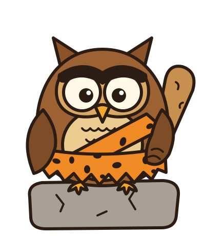

<p align="center">
  
</p>

# caveowl

Teach a 35B mixture-of-experts model to answer in caveman style, terse in its weights rather than
in a system prompt, without losing its tool calls, its code or its agent skills.

caveowl is a bf16 LoRA recipe for
[ornith-ai/Ornith-1.5-35B-A3B](https://huggingface.co/ornith-ai/Ornith-1.5-35B-A3B) (a Qwen3.6-35B-A3B
fine-tune), trained with [Unsloth](https://github.com/unslothai/unsloth). It ports
[JuliusBrussee/cavegemma](https://github.com/JuliusBrussee/cavegemma) to a bigger model and adds
the data a model needs to stay a working agent while it learns the style. It was developed on one
AMD Strix Halo box (128 GB unified memory) and runs as that box's everyday assistant model.

The recipe, the data builders and the gate are here. The weights (run 5) are on Hugging Face at
[stefanj0/caveowl-35b-a3b](https://huggingface.co/stefanj0/caveowl-35b-a3b): a Q4_K_M GGUF for
llama.cpp, the vision projector and the LoRA adapter. Its model card is
[`docs/hf-model-card.md`](docs/hf-model-card.md).

**Just point your agent here.** Tell your coding agent (Claude Code, Codex, pi, ...) to read
[`llms.txt`](llms.txt) and train caveowl for you. It lists the decisions to ask you about first,
every command in order, how to check each step, and the failures seen so far.

## What it does

Same prompt, same server settings, temperature 0:

> **Prompt:** Summarize this in two sentences: The 1986 Chernobyl disaster resulted from a flawed
> reactor design combined with inadequately trained personnel. During a test of the reactor's
> ability to cool itself during a power failure, operators disabled key safety systems, and a
> sudden power surge led to explosions that destroyed the reactor core, releasing large amounts
> of radioactive material into the atmosphere.
>
> **Stock Ornith (44 words):** The 1986 Chernobyl disaster was caused by a flawed reactor design and
> inadequately trained personnel who disabled safety systems during a test. A sudden power surge
> then triggered explosions that destroyed the reactor core and released massive amounts of
> radioactive material into the atmosphere.
>
> **caveowl (30 words):** Chernobyl disaster (1986) caused by flawed reactor design and inadequately
> trained personnel. Operators disabled safety systems during test, power surge caused explosions,
> destroyed reactor core, released radioactive material into atmosphere.

Against stock Ornith, both served at temperature 0.3 on the same llama.cpp build and flags:

| Check | Stock | caveowl |
|---|---|---|
| Tokens for 16 ordinary chat answers | 2,544 | **992** |
| Words per answer with thinking on (median) | 312 | **66** |
| Tool-call arguments, 3 prompts x 30 samples | 90/90 | 90/90 |
| Python code tasks / held-out sh, R, Rust tasks | 10/12, 58/90 | 10/12, 58/90 |
| Agent skill tasks completed (pi) | 44/45 | 45/45 |
| Wider skill set, 8 skill families | 30/81 | **38/81** |
| Reasoning leaking into answers | 0/16 | 0/16 |

Terse answers cost detail: caveowl keeps the facts it states but states fewer of them. Read the
answers your use depends on before you deploy it.

## What you need

- **A GPU with about 90 GB of memory.** bf16 LoRA on all 256 experts trains ~0.94B parameters;
  the measured peak was 84 GiB allocated and 88 GiB reserved at 16,384-token rows. It was trained
  on an AMD Ryzen AI Max+ 395 (gfx1151, ROCm 7.13 PyTorch). Unsloth supports NVIDIA too, but this
  recipe was not run there. 4-bit QLoRA (~35-40 GiB) is a config switch, untested, and Unsloth
  advises against it for this architecture.
- **Time.** One epoch is 241 optimiser steps and took about 14 hours on Strix Halo.
- **Disk.** ~67 GB for the bf16 base, ~67 GB for the merged model, ~85 GB for the GGUF
  conversion (BF16 + Q4_K_M), plus the stock Q4_K_M GGUF (21 GB).
- **[llama.cpp](https://github.com/ggml-org/llama.cpp)** with `llama-server`, `llama-imatrix`,
  `llama-quantize` and `convert_hf_to_gguf.py`, to generate data from the stock model, convert
  the result and serve it.
- **Optional:**
  - [pi](https://github.com/earendil-works/pi), the coding agent, for the skill-trajectory data
    and the skill gates.
  - [llm-bench-kit](https://github.com/sjvrensburg/llm-bench-kit) for the tool and code gates.
  - An Anthropic API key, for the Claude rewrites that build the caveman text pairs, the tool
    slice's prose and the agent-loop answers. Every rewrite has a `--dry-run` that prints the cost
    first.

## Train your own

Commands run from the repo root. `PY` is the training environment's Python.

### 1. Environment

Python 3.12 with a PyTorch build for your GPU, then Unsloth and the DeltaNet kernels:

```bash
uv venv --python 3.12 ~/venvs/caveowl
# install torch for your platform first (ROCm or CUDA wheel), then:
uv pip install --python ~/venvs/caveowl/bin/python "unsloth[amd]"          # or plain "unsloth" on NVIDIA
uv pip install --python ~/venvs/caveowl/bin/python flash-linear-attention==0.5.2
export PY=~/venvs/caveowl/bin/python HF_HUB_DISABLE_XET=1
```

Versions that worked: unsloth 2026.10.3, transformers 5.17.0, torch 2.11.0+rocm7.13.0,
flash-linear-attention 0.5.2. On ROCm, `causal_conv1d` has no build, so DeltaNet's short
convolution runs a slower PyTorch fallback; that is expected.

### 2. Base model

```bash
hf download ornith-ai/Ornith-1.5-35B-A3B --revision 10fbf86fed7ecee4a061f8b499a618f46001cac1 \
    --local-dir ~/models/ornith-35b-hf
hf download ornith-ai/Ornith-1.5-35B-A3B-GGUF --include "*Q4_K_M*" "*mmproj*" --local-dir ~/models/ornith-35b
```

The bf16 checkpoint is what you train. The stock Q4_K_M GGUF is the "before" model: it generates
the self-distilled data and is the baseline every gate compares against.
`template/ornith-gguf-chat-template.jinja` is the chat template embedded in that GGUF, and the
trainer renders every row through it so that training sees exactly what the server sends.

### 3. Data

The mix has eight slices (below, "Data"). Two are model-independent and you bring them; the rest
are generated from the stock model, which you serve on a spare port first:

```bash
BENCH_PORT=8110 LLAMA_SERVER=~/src/llama.cpp/build/bin/llama-server \
    MMPROJ=~/models/ornith-35b/mmproj-Ornith-1.5-35B-BF16.gguf \
    scripts/serve_bench.sh ~/models/ornith-35b/Ornith-1.5-35B-Q4_K_M.gguf 0.6 &
export CAVEOWL_BENCH_URL=http://127.0.0.1:8110/v1
```

Every builder and gate defaults to `CAVEOWL_BENCH_URL`. To stop them from ever pointing at a server
you or others rely on, list its ports in `~/.config/caveowl/live-ports` (for example `8080 8081`)
or `CAVEOWL_LIVE_PORTS`; they refuse those ports.

```bash
# code anchors: stock's own test-passing answers (MBPP Python + UltraData-Code sh/R/Rust)
$PY data/build_anchor.py
$PY data/build_anchor_ultra.py --validate      # runs the dataset's own tests in bwrap
$PY data/build_anchor_ultra.py
$PY data/merge_anchors.py                      # also holds out 90 tasks for the gate

# bounded tool calls and thinking-on rows, both from stock
$PY data/build_bound_anchor.py --n 900
$PY data/build_think_anchor.py --n 450

# agent skill trajectories through real pi sessions (needs pi and the skills; see "Data")
$PY data/build_skill_anchor.py --extra-attempts 2 --max-len 16384
```

Then check the whole mix renders and masks correctly without loading any weights:

```bash
$PY train_unsloth.py --config config.toml --prepare-only
```

It prints one masked example of each kind (loss-bearing text in `⟦ ⟧`) and per-slice token counts.

### 4. Smoke test, then train

```bash
$PY train_unsloth.py --config config_smoke.toml --no-resume   # 2 steps on the 32 longest rows
$PY train_unsloth.py --config config.toml                     # 1 epoch, checkpoint every 25 steps
```

The smoke run prints the trainable parameter count, peak memory and seconds per step. If it
reports `routed-expert LoRA 0.0M`, Unsloth's MoE path did not attach and only attention, DeltaNet
and the shared expert would train. The full run resumes from its newest checkpoint if
interrupted.

On a machine where other model servers share the GPU, stop them first; the trainer loads the
checkpoint with `pread` rather than `mmap`, so the CPU never holds a second copy of the weights
(`owl_load.py`).

### 5. Merge and convert

```bash
LLAMA=~/src/llama.cpp bash merge_and_gguf.sh      # ADAPTER=artifacts/adapter by default
```

This merges the adapter into the bf16 base (checking that untouched tensors, the vision tower and
the MTP head come through byte-identical), converts to a BF16 GGUF, computes an importance matrix
on wikitext-2's train split and quantizes to Q4_K_M, all under `artifacts/`. The stock model's
vision projector works unchanged with the result, because the LoRA never touches the vision tower.

### 6. Gate it

Serve stock and the candidate one at a time on the same port and flags, and run the same checks on
both. `scripts/gate.sh` does the whole sequence:

```bash
T=0.3 OWL=artifacts/gguf/Ornith-1.5-35B-caveowl-Q4_K_M.gguf OWL_LABEL=caveowl \
    PI_MODELS_JSON=~/my-bench-models.json KIT=~/src/llm-bench-kit bash scripts/gate.sh
```

See "The gate" below for what each check catches and how to read it.

### 7. Serve it

```bash
llama-server --model artifacts/gguf/Ornith-1.5-35B-caveowl-Q4_K_M.gguf \
    --mmproj ~/models/ornith-35b/mmproj-Ornith-1.5-35B-BF16.gguf \
    --jinja --reasoning-format deepseek --temp 0.3 --top-k 20 --top-p 0.95 \
    --ctx-size 262144 --parallel 2 --flash-attn on --cache-type-k q8_0 --cache-type-v q8_0
```

Serve it at **temperature 0.3**. At 0.6 it occasionally leaves out an argument the user asked
for: in 2 of 90 sampled tool calls it dropped a requested `max_results`, which stock never did.
At 0.3 that went away.

## Data

Shares are relative to the text pairs; set a share to 0 in `config.toml` to drop a slice.

| Slice | Share | Rows | What it teaches | Source |
|---|---:|---:|---|---|
| Caveman text pairs | base | 1,679 | the style | you bring it, see below |
| Tool calls | 25% | 439 | keep tool calls exact while the prose changes | you bring it, see below |
| Code anchors | 20% | 420 | stay as good at code as before | stock's answers to MBPP and UltraData-Code tasks, kept only if the tests pass |
| Skill trajectories | 15% x2 | 382 | open a skill's instructions, run its script, ground the answer | stock driven through real pi sessions, judged, failures pruned |
| Agent loops | 10% | 180 | long multi-step tool use, skills listed but not needed | [julien-c/synthtraces](https://huggingface.co/datasets/julien-c/synthtraces) Qwen3.6 sessions, answers caveman-rewritten |
| Bounded tool calls | 25% | 560 | carry the limit the user stated into the call | stock's calls on two-requirement prompts, kept only if correct |
| Thinking-on rows | 10% | 187 | close the reasoning, then answer | stock's reasoning + the caveman answer |

Rows for the 35B run at the recipe above: 3,847 rows, 4.8M tokens, 22% of them carrying loss.

**Caveman text pairs** (`data/in/text_train.jsonl`, `data/in/text_eval.jsonl`). Build them with
[JuliusBrussee/cavegemma](https://github.com/JuliusBrussee/cavegemma)'s corpus pipeline
(`data/build_corpus.py`, `synthesize.py`): prompts from permissively licensed sources, answers
rewritten in caveman style by Claude. Rows are `{"prompt": ..., "target": ...}` (plus optional
`category`, `context`). `data/synthesize_batch.py` does the Claude rewrite through the Message
Batches API, half the price of single calls; run cavegemma's `filter.py` and `split.py` on its
output.

**Tool calls** (`data/in/tool.jsonl`). One JSON object per row:

```json
{"key": "...", "category": "tool_conv",
 "tools": [{"type": "function", "function": {"name": "...", "description": "...", "parameters": {}}}],
 "messages": [
   {"role": "user", "content": "..."},
   {"role": "assistant", "content": "", "tool_calls": [{"id": "call_0", "type": "function",
     "function": {"name": "...", "arguments": {}}}]},
   {"role": "tool", "tool_call_id": "call_0", "content": "..."},
   {"role": "assistant", "content": "caveman prose ..."}]}
```

The release used rows from
[nvidia/Nemotron-Agentic-v1](https://huggingface.co/datasets/nvidia/Nemotron-Agentic-v1)
(multi-turn, assistant prose rewritten in caveman style, calls and results unchanged) and xLAM
call-only rows from [HuggingFaceTB/smoltalk2](https://huggingface.co/datasets/HuggingFaceTB/smoltalk2),
both CC-BY-4.0. Build it with `data/build_tool_corpus.py` (fetches and normalises the rows),
`data/synthesize_batch.py --tool-corpus` (rewrites only the prose, through Claude's Message
Batches API) and `data/filter_tool_pairs.py` (keeps rows whose calls and results are unchanged
and whose prose actually got shorter). Any rows in this shape work.

**Skill trajectories** depend on your agent. `data/build_skill_anchor.py` drives real pi sessions
against the stock model in throwaway directories, keeps the ones that read the skill, ran its
script and answered from its output, and rewrites paths to production's. Its prompt sets
(`data/build_skill_anchor.py`, `data/skill_run2.py`, `data/skill_run4.py`) target the skills the
author has installed: weather, system health, PDF reading and exploration, summarizing, humanizing
text, explaining simply and a coffee-price tracker. Write prompts for your own skills, or set
`skill_share = 0` if the model will not run as an agent. `data/pi_bench_guard.ts` is the only pi
extension loaded during these runs; it blocks anything that sends, spends, installs or writes
outside the scratch directory. Put your machine's secret locations in
`~/.config/caveowl/bench-guard-extra.txt`, one regex per line.

**Agent loops.** `data/build_synthtraces.py` converts synthtraces sessions to rows (first exchange,
thinking dropped), `data/synthesize_batch.py --tool-corpus` rewrites their answers, and
`data/skills_wrap_ext.py` adds a list of skills that do not apply (copied from your skill
trajectories' system prompts). The release did not filter these rows; running
`data/filter_tool_pairs.py` on them first is stricter and keeps far fewer. Without the rewrite,
set `ext_share = 0`.

How rows are rendered and masked, which modules get LoRA and where the memory goes:
[docs/internals.md](docs/internals.md).

## The gate

Every check runs on stock and the candidate, one at a time, on the same port, binary, flags and
temperature. A check passes when the candidate is at least as good as stock, within the noise
noted.

| Check | Catches | Tool |
|---|---|---|
| Tool arguments, greedy and at the served temperature (3 prompts x 30) | a dropped or invented argument | llm-bench-kit `tool-harness.py`, `sampler-check.py` |
| Tool use through pi's real prompt | agent-harness regressions | llm-bench-kit `pi-tool-harness.py` |
| Code, Python and held-out sh/R/Rust | the style leaking into code | llm-bench-kit `code-eval.py`, `eval/code_heldout.py` |
| Reasoning leak, thinking off | `<think>` text in answers | `scripts/gate.sh` `LEAK=` hook |
| Thinking on | answers left inside an unclosed think block | `eval/think_on.py` |
| Skill follow-through | the model sees a skill and never reads it | `eval/skill_gate.py` (optionally with your agent's `AGENTS.md`) |
| Wide skill set | the same, for skills not in the training data | `eval/skill_gate_wide.py` |
| Perplexity on wikitext-2 test | gross damage | `llama-perplexity` |

Stock varies between nights (its wide-skill score ranged 28 to 34 of 81), so compare arms run
the same evening, and repeat a close check with more samples before believing it.

## What five runs taught

The full record, with every number, is in [docs/runs.md](docs/runs.md).

1. **Style generalises; skill use does not.** The model reads a skill's instructions only for skill
   families it saw in training. Families without trajectories fell below stock.
2. **Every data source must look like production.** Agent loops whose system prompt listed no
   skills taught "solve it with bash" and sent PDF questions from 5/12 to 0/12. Listing skills
   that did not apply fixed it and lifted every family.
3. **Train thinking-on rows if anyone will call it with thinking on.** A model trained only
   thinking-off wrote its whole answer inside the reasoning and never closed it: 26 of 32 empty
   answers, against stock's 0.
4. **Check tool arguments at the temperature you will serve.** Greedy decoding showed nothing.
   The dropped argument appeared only when sampling, at 2-5 per 90 calls, and 30 samples could
   not tell it from noise.
5. **Self-distil the anchors.** Code, tool-call and thinking anchors are stock's own outputs,
   kept only when they verifiably pass; they hold the model where it was while the style moves.
6. **Load with `pread` on unified memory.** transformers' memory-mapped loading kept a full CPU
   copy of the 67 GB checkpoint and the first smoke run was killed by the kernel's OOM killer.

## Adapting it to another model

The pipeline is model-specific in four places: the chat template (`template/`, extracted from the
GGUF you will serve), the LoRA target names (`config.toml [lora]`, check them with
`checks/attach_tiny.py`), the masking assumptions about the think block (`owl_data.py`), and the
merge checks (`merge_owl.py`). The self-distilled slices must be regenerated from the new stock
model; the text pairs and tool rows can be reused.

## Repository layout

| Path | What |
|---|---|
| `config.toml`, `config_smoke.toml` | the recipe and its memory smoke test |
| `train_unsloth.py`, `owl_data.py`, `owl_load.py` | trainer, rendering and loss masks, checkpoint loading |
| `data/` | slice builders, the Claude batch rewriter (`synthesize_batch.py`) and filters |
| `eval/` | the skill, thinking-on and held-out code gates |
| `merge_and_gguf.sh`, `merge_owl.py` | merge, convert, quantize |
| `scripts/serve_bench.sh`, `scripts/gate.sh` | bench server and the full gate |
| `owl_ports.py` | bench URL default and live-port refusal |
| `configs/runs/`, `docs/runs.md` | each run's config and results |
| `takedown_servers.sh`, `restore_servers.sh`, `scripts/run_full.sh`, `scripts/smoke.sh` | the author's wrappers for stopping systemd-managed model servers around a run; adapt or ignore |

## Licences and credits

- **Code and docs here:** MIT (`LICENSE`), as cavegemma. The weights and generated data are not
  in the repo.
- **Base model:** Ornith-1.5-35B-A3B by ornith-ai, MIT. An adapter or merged model is a derivative
  under its terms.
- **Pipeline and caveman style:** [cavegemma](https://github.com/JuliusBrussee/cavegemma) and
  [caveman](https://github.com/JuliusBrussee/caveman) by Julius Brussee, MIT.
- **Tool rows** (CC-BY-4.0): material derived from *Nemotron-Agentic-v1* © NVIDIA Corporation and
  from *xLAM-function-calling-60k* © Salesforce (as redistributed in *SmolTalk2* by Hugging Face).
  Changes: rows filtered and normalised to one message format, long tool results truncated,
  Nemotron's assistant prose rewritten in caveman style by Claude; tool calls and results
  unchanged. A model trained on them must carry this notice.
- **Code anchors:** prompts and tests from *google-research-datasets/mbpp* (CC-BY-4.0) and
  *openbmb/UltraData-Code* L3 sh/R/Rust (Apache-2.0; its card asks users to respect the source
  repositories' licences and forbids unchanged redistribution). Answers are the stock model's
  own; the dataset's reference solutions are never trained on.
- **Agent loops:** [julien-c/synthtraces](https://huggingface.co/datasets/julien-c/synthtraces)
  (MIT), answers rewritten by Claude.
- **Skill trajectories:** generated locally; they quote the installed skills' instructions and
  the machine's command output, so review them before sharing.
